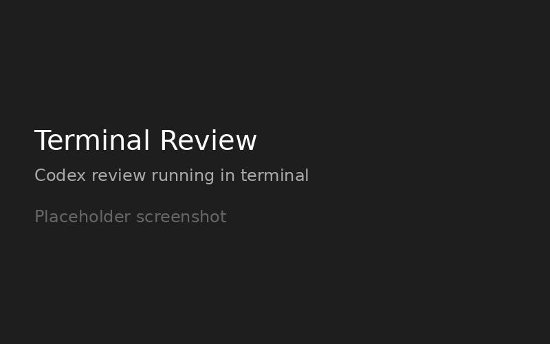
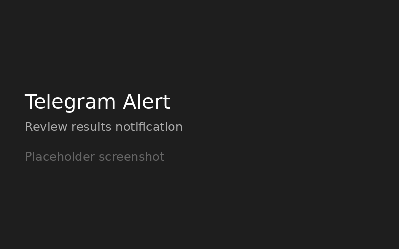
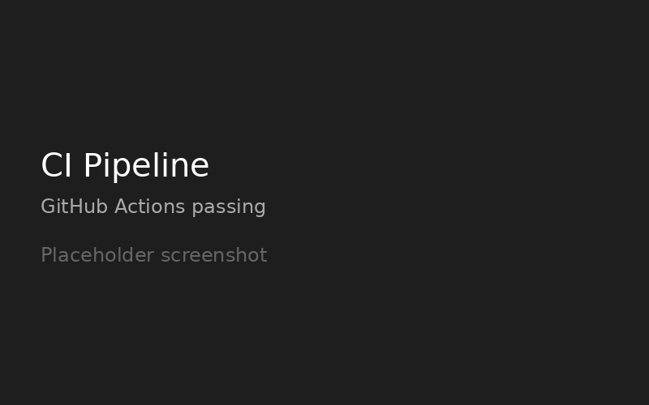

# Codex Review Setup


**Productized automation setup:** Codex review + research pipeline + Telegram alerts + systemd timers + GitHub Actions CI.

Turn any Python repo into a self-reviewing project in under 1 hour.

---

## What You Get

- ✅ Automated Codex review on schedule
- ✅ Research pipeline for any topic
- ✅ Telegram alerts on material issues
- ✅ Systemd user timers (no fragile cron)
- ✅ Pre-configured pytest + coverage + mypy + ruff
- ✅ GitHub Actions CI with 4 jobs
- ✅ Secret scanning and shell validation
- ✅ Full documentation and quickstart

## Pricing

| Tier | Price | What's Included |
|------|-------|-----------------|
| **Starter** | $297 | Repo audit + setup + 1 week support |
| **Standard** | $497 | Starter + custom workflows + CI |
| **Premium** | $797 | Standard + training + 30 days support |

## How It Works

1. **You share** your repo and requirements
2. **I set up** the full automation stack in 1-2 hours
3. **You get** scheduled reviews, alerts, and CI
4. **You save** 5-10 hours/month on manual reviews

## Tech Stack

- OpenAI Codex CLI (review + research)
- pytest + coverage + mypy + ruff
- systemd user timers (Mon/Wed/Thu 9am)
- Telegram bot notifications
- GitHub Actions CI
- Python 3.14, bash, YAML

## Screenshots





## Quick Start

```bash
git clone https://github.com/AlexKrikovluk/codex-review-starter.git
cd codex-review-starter
cp .env.example .env
# Edit .env with your Telegram bot token and chat ID
./scripts/install.sh
```

See [QUICKSTART.md](QUICKSTART.md) for detailed setup.

## Real-World Example

We used this stack on the [python-scripts](https://github.com/AlexKrikovluk/python-scripts) repo:

- **31 passing tests** with 94.69% coverage
- **mypy strict** — zero type errors
- **3x/week automated reviews** via systemd timers
- **Telegram alerts** only for material issues
- **Research pipeline** generating topic reports

Before: manual reviews when remembered, inconsistent CI, missed issues.
After: scheduled reviews, clean CI, alerts only when needed.

## Roadmap

- [x] Core automation stack (Codex + systemd + Telegram)
- [x] GitHub Actions CI with lint, tests, security
- [x] Research pipeline
- [x] Expansion Pack 1: FastAPI template, multi-repo, Docker, GitHub App
- [x] Expansion Pack 2: VS Code extension, web dashboard, enhanced CI
- [ ] Multi-language support
- [ ] AI-powered auto-fix suggestions
- [ ] Cloud-hosted version

## Contributing

PRs welcome. Please read [CONTRIBUTING.md](CONTRIBUTING.md) first.

## FAQ

**Q: Do I need Codex CLI installed?**
A: Yes, but I guide you through OAuth setup. It takes 5 minutes.

**Q: Can I customize the schedule?**
A: Yes, systemd timers are easy to modify. Default is Mon/Wed/Thu 9am.

**Q: What if I don't use Telegram?**
A: Alerts can go to Discord, Slack, or email. Telegram is default but flexible.

**Q: Do you support private repos?**
A: Yes, all work is done in your environment. No code leaves your machine.

## Contact

- **Telegram:** @AlexKrikovluk
- **Email:** alexkrikovluk@gmail.com
- **X/Twitter:** @AlexKrikovluk
- **GitHub:** [@AlexKrikovluk](https://github.com/AlexKrikovluk)

## Landing Page

Hosted landing page: https://alexkrikovluk.github.io/codex-review-starter/

Or view [`index.html`](index.html) locally.

## License

MIT — use this template for your own projects.
